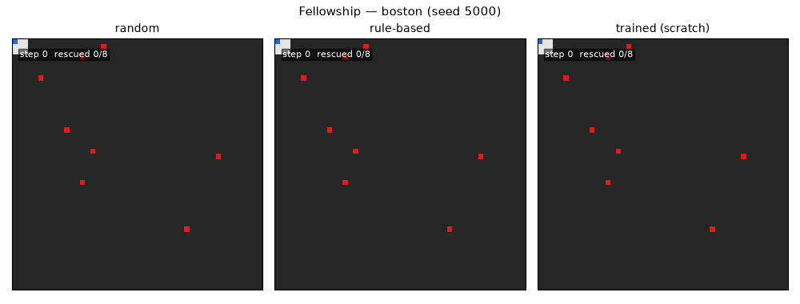
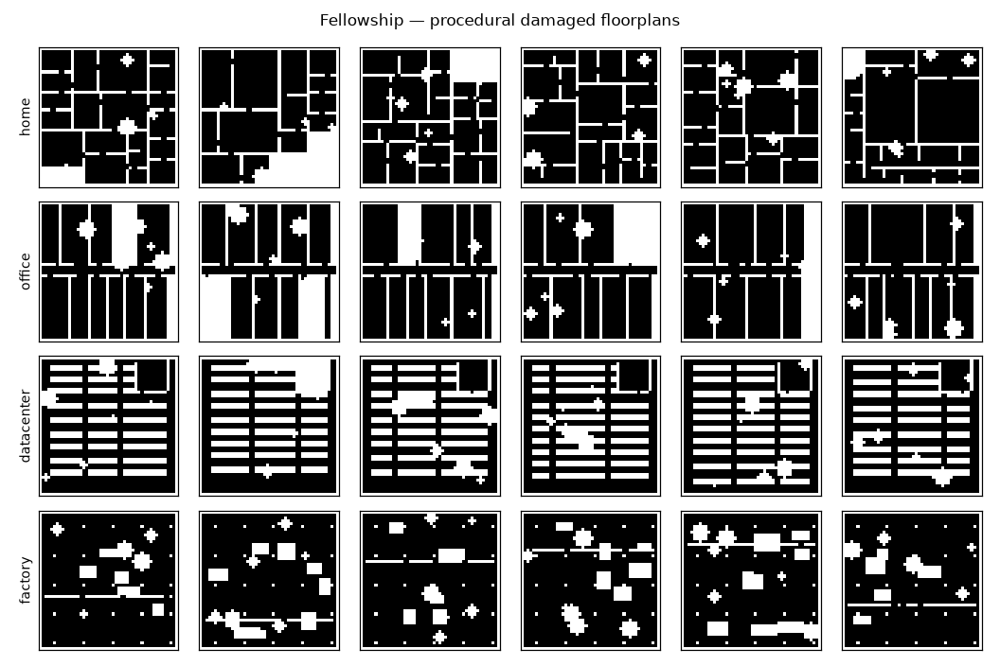
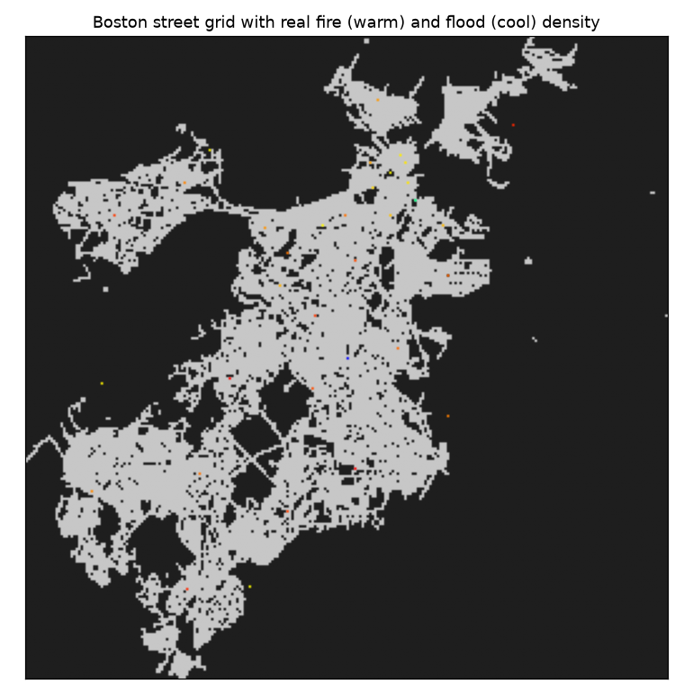
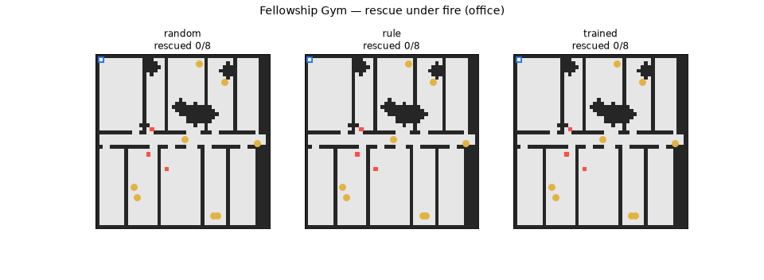
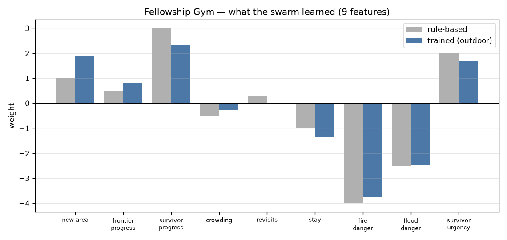

# Fellowship Gym



[](https://colab.research.google.com/github/Zpopowitz/fellowship/blob/main/demo.ipynb)

**Search-and-rescue training environments built from real Boston streets and damaged buildings, plus a dataset, for training robot swarms without risking real robots.**

## Why

Real-world robot data is slow to gather, expensive, and impossible to collect safely in a disaster — you cannot set a building on fire to see how a drone swarm behaves. Fellowship Gym is a fast grid-world stand-in: real places, spreading hazards, decentralized robots, and a ready-made dataset, so you can train and benchmark swarm policies on a laptop and only then take them near real hardware. (Hackachusetts Robotics, challenge R2: training environments of real places + data for physical-AI training.)

## Quickstart

```bash
pip install git+https://github.com/Zpopowitz/fellowship
```

```python
import fellowship
from fellowship.benchmark import evaluate_policy

env = fellowship.make_env(task="rescue", maps="buildings", seed=0)   # a PettingZoo ParallelEnv
obs, _ = env.reset(seed=0)
print(evaluate_policy(lambda f, m, rng: int(m.argmax()), task="rescue", maps="buildings", n_maps=10))
```

See [`examples/train_your_own.py`](examples/train_your_own.py) for a complete custom-policy benchmark in under 40 lines.

## Tasks

`fellowship.list_tasks()` × `fellowship.list_map_families()`:

| Task | Goal | Hazards | Map families |
|---|---|---|---|
| `explore` | fraction of the map covered | none | streets_real, streets_grid, buildings |
| `rescue` | survivors found (of 8) | none | streets_real, streets_grid, buildings |
| `rescue_fire` | survivors found, drones kept | fire (spreads) | streets_real, streets_grid, buildings |
| `rescue_flood` | survivors found | flood (blocks routes) | streets_real, streets_grid, buildings |

Map families: **streets_real** = a georeferenced 71 m grid built from City of Boston data (`kind="sar"`); **streets_grid** = the Moving AI `Boston_0_256` grid (`kind="boston"`); **buildings** = procedurally damaged home / office / data-center / factory floorplans.

## The places





The buildings are generated and then damaged (rubble), keeping only the largest connected open area so every survivor is reachable. The Boston grid is a 256×256 street-occupancy map; the warm/cool overlay is **real** fire and flood density (4,281 Boston fire incidents, 26 flood events) geocoded onto it.

## Dataset

Full swarm trajectories for training physical-AI models, recorded on **training seeds only** (0–3999; the benchmark maps at 5000+ are never recorded). Two policies drive it (`rule`, `trained`), across every task × map family.

- `dataset/sample/steps.parquet` — one row per robot per step: position, action, the 9-feature vector, legal-action mask, rescues so far, drone-lost flag.
- `dataset/sample/episodes.parquet` — one row per episode: rescued, explored, steps, drones lost, survivors left in hazards.
- `dataset/sample/maps/` — the 240 floorplans, the Boston grid, and the fire/flood density layers.

A 5-episode-per-combination **sample** (120 episodes, ~1.7 MB) is committed. Regenerate the full export with `python scripts/export_dataset.py`. Full card: [`dataset/README.md`](dataset/README.md).

## Baselines



*Random / rule / trained swarms on the same office floorplan with fire spreading — the fire disables drones faster than any current baseline adapts.*

<!-- HAZARDS:BEGIN -->
24 held-out maps per situation (seeds 5000+), the same maps and seeds for every policy. Mean ± std. Rescued of 8, drones lost of 4. 'Abandoned' = survivors left in fire or flood at the end. 'Burned' = fraction of open cells on fire at episode end.

## indoor

| Policy | Rescued /8 | Drones lost /4 | Abandoned | Firefighter score | Burned % |
|---|---|---|---|---|---|
| random | 0.6 ± 0.7 | 0.3 ± 0.9 | 1.8 ± 1.2 | -1.0 ± 10.4 | 12 ± 4 |
| blind | 4.4 ± 1.8 | 2.3 ± 1.2 | 1.2 ± 1.0 | 37.6 ± 18.6 | 11 ± 4 |
| rule | 4.5 ± 1.8 | 1.9 ± 1.3 | 1.4 ± 1.1 | 37.7 ± 20.2 | 12 ± 4 |
| hand-set (indoor) | 4.2 ± 1.6 | 2.0 ± 1.4 | 1.2 ± 1.1 | 36.4 ± 17.9 | 11 ± 4 |
| trained | 4.2 ± 2.0 | 2.0 ± 1.4 | 1.4 ± 1.1 | 34.7 ± 20.8 | 11 ± 4 |

## outdoor

| Policy | Rescued /8 | Drones lost /4 | Abandoned | Firefighter score | Burned % |
|---|---|---|---|---|---|
| random | 0.5 ± 0.6 | 1.0 ± 1.4 | 2.0 ± 1.8 | -4.0 ± 9.9 | 21 ± 11 |
| blind | 6.0 ± 2.1 | 2.6 ± 1.3 | 0.9 ± 1.3 | 54.2 ± 25.6 | 19 ± 11 |
| rule | 5.2 ± 2.0 | 2.4 ± 1.3 | 1.3 ± 1.5 | 45.6 ± 24.4 | 19 ± 11 |
| hand-set (outdoor) | 5.5 ± 2.1 | 2.1 ± 1.4 | 1.2 ± 1.6 | 48.4 ± 26.3 | 20 ± 11 |
| trained | 5.1 ± 2.2 | 2.0 ± 1.4 | 1.2 ± 1.5 | 44.9 ± 26.4 | 20 ± 11 |

## flood

| Policy | Rescued /8 | Drones lost /4 | Abandoned | Firefighter score | Burned % |
|---|---|---|---|---|---|
| random | 0.8 ± 1.4 | 0.9 ± 1.2 | 2.2 ± 1.5 | -1.9 ± 14.9 | 20 ± 7 |
| blind | 5.5 ± 2.3 | 2.2 ± 1.5 | 1.0 ± 1.2 | 49.9 ± 27.2 | 15 ± 8 |
| rule | 5.2 ± 2.6 | 2.1 ± 1.4 | 1.1 ± 1.1 | 46.6 ± 29.1 | 15 ± 8 |
| hand-set (flood) | 5.4 ± 2.5 | 2.0 ± 1.6 | 1.1 ± 1.1 | 48.1 ± 28.7 | 15 ± 7 |
| trained | 5.2 ± 2.4 | 1.9 ± 1.6 | 1.0 ± 1.1 | 46.7 ± 26.9 | 16 ± 8 |
<!-- HAZARDS:END -->

Full tables per task: [`LEADERBOARD.md`](LEADERBOARD.md) (12 held-out maps per task × map family, seeds 5000+). The headline, all from held-out maps:

- **Coordination is the whole game.** A random swarm rescues ~0.6 of 8; a coordinated swarm (rule or trained) rescues ~6–7 on clear maps. Decentralized map-sharing and spreading out is what gets survivors out.
- **Training ≈ hand-tuning.** The CEM-trained policy is within noise of the hand-tuned rule (e.g. streets_real rescue 7.4 vs 7.2; buildings 6.2 vs 6.2). The hand weights were already near-optimal; training confirms rather than beats them.
- **The hazard tasks are unsolved.** Under fire or flood, *every* baseline loses 2–3 of its 4 drones and still leaves ~1–2 survivors in the hazard. Safe rescue under spreading fire is the open challenge this gym exists to measure — the sensors (thermal IR, drifting smoke), known-fire avoidance and fresh-fire re-sensing are all in the environment; what is missing is a policy that uses them well.

## What the swarm learned



The learned weights push **away from crowding** (robots spread out) and **away from fire** once hazards are on. The decision model scores each of 5 moves on 9 features — new area, frontier progress, survivor progress, crowding, revisits, stay, fire danger, flood danger, survivor urgency — under a **firefighter objective**: a rescue is worth 10, a lost drone costs 1, a survivor left in fire costs 4. That trades drones for lives on purpose, the way fire-service doctrine does.

## How to run

```bash
pip install -r requirements.txt
python -m demo                      # one 3-panel hazard episode -> results/demo.gif (<60s, no training)
python -m train                     # cross-entropy training (base rescue policy)
python -m train_situations          # per-situation models (indoor/outdoor/flood, firefighter objective)
python -m evaluate                  # held-out basic results -> results/results.md
python -m evaluate_hazards          # held-out hazard results -> results/hazards.md
python scripts/run_baselines.py     # LEADERBOARD.md
python scripts/export_dataset.py    # dataset/ (training seeds)
python -m render                    # GIFs
pytest -q                           # 62 tests
python pipeline/build.py            # rebuild data/processed/ (needs scripts/download_boston_data.py first)
```

## How Kiro was used

- **Steering** (`.kiro/steering/`): three docs pinning product goals, tech constraints, and file layout — including the rule that every reported number comes from held-out seeds.
- **Specs** (`.kiro/specs/`): the original build spec plus a second spec for the hazards/SAR/dataset work.
- **Hooks** (`.kiro/hooks/fellowship-hooks.json`): one v1-format file — tests-on-save, floorplan-preview regen, smoke training, README sync, and an agent steering-check that enforces the held-out-numbers rule.
- **Property tests** (hypothesis): 62 tests; the bugs they caught (gas-plume direction, stale-fire decisions, disabled-drone relaying, reachability) are logged in [`docs/kiro_log.md`](docs/kiro_log.md).
- **MCP** ([`.kiro/settings/mcp.json`](.kiro/settings/mcp.json)): `fetch` to check the env against the official PettingZoo ParallelEnv contract; `github` to publish and manage the repo.

## Team

- **Zachary Popowitz** — gym, environment, policies, training, benchmark.
- **Aaron** — data pipeline.
- **Decio** — raw Boston SAR data.

(Full names to be confirmed by the team.)

## Limits

- Grid world, not real physics; 71 m cells; survivors placed at random (or biased toward real fire density on `sar` maps).
- **Rescue status is global**: a robot's "rescued so far" reflects team rescues even for survivors found out of its radio range. Everything else (maps, hazards, sightings) obeys radio range; this one counter does not yet.
- Fire is geocoded only to ZIP centroid; flood only to county.
- The Moving AI `streets_grid` is **not** georeferenced — the pipeline found chance-level overlap with the real street network — which is why the georeferenced `streets_real` maps exist.
- Floorplans are procedural, not scanned buildings.

## Results (basic, non-hazard)

<!-- RESULTS:BEGIN -->
All numbers are from **held-out maps** (eval seeds ≥ 5000), never used in training. 20 maps per kind, 100 total, same maps and seeds for every policy.

### Rescued (of 8), mean ± std, 20 held-out maps/kind (100 total)

| policy | boston | home | office | datacenter | factory | overall |
|---|---|---|---|---|---|---|
| random | 0.40 ± 0.58 | 0.20 ± 0.40 | 0.35 ± 0.65 | 0.35 ± 0.73 | 0.40 ± 0.80 | 0.34 ± 0.65 |
| rule | 6.55 ± 1.53 | 5.20 ± 1.54 | 6.15 ± 1.28 | 5.85 ± 2.06 | 7.15 ± 0.91 | 6.18 ± 1.65 |
| scratch | 6.50 ± 1.40 | 5.30 ± 1.55 | 5.85 ± 1.56 | 6.20 ± 1.33 | 7.15 ± 0.91 | 6.20 ± 1.50 |
| warm-start | 6.65 ± 1.49 | 5.40 ± 1.85 | 5.50 ± 1.24 | 5.75 ± 1.30 | 7.15 ± 1.01 | 6.09 ± 1.57 |

### Explored %, overall · Steps used, overall

| policy | explored % (overall) | steps (overall) |
|---|---|---|
| random | 9.07 ± 3.37 | 160.00 ± 0.00 |
| rule | 74.97 ± 12.83 | 152.62 ± 15.42 |
| scratch | 76.83 ± 11.78 | 156.47 ± 9.45 |
| warm-start | 75.28 ± 12.95 | 155.07 ± 11.78 |

### Communication ablation (best policy: scratch)

| COMM | rescued (of 8) | explored % |
|---|---|---|
| 3 | 5.69 ± 1.62 | 71.6 |
| 10 | 5.87 ± 1.71 | 76.6 |
| 100 | 6.33 ± 1.48 | 76.4 |
<!-- RESULTS:END -->

## Data credits and license

- **Code & dataset:** MIT — see [`LICENSE`](LICENSE).
- **City of Boston open data** (streets, fire incidents, hydrants): PDDL — see [`docs/DATA_SOURCES.md`](docs/DATA_SOURCES.md).
- **Moving AI `Boston_0_256` grid:** Sturtevant, "Benchmarks for Grid-Based Pathfinding", IEEE TCIAIG 2012.
- **MBTA data:** under MBTA licensing terms.
